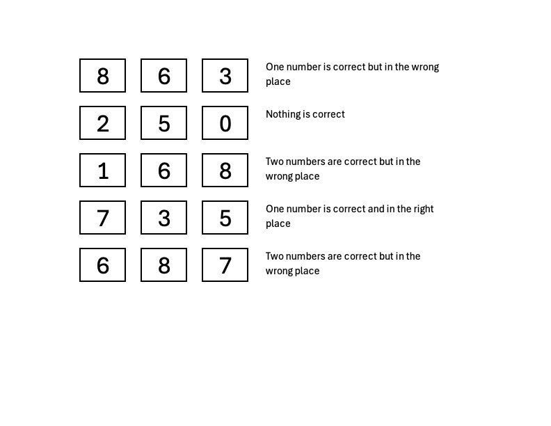

# DECODE-DLE

## Challenge Information

| Field | Details |
|:---|:---|
| **Competition** | [DeadFace 2026](https://ctf.deadface.io/) |
| **Category** | Cryptography |
| **Points** | 25 |
| **Author** | @G2Gh0st |

## Description

One of the junior DEADFACE members left a number puzzle to decipher a 3-digit number combination. Do you have the skills to solve the puzzle and open the lock? Follow the clues to decipher the 3-digit code needed to "pick" the lock. Enter the code as 3 digits, no spaces or other separating characters.

Submit the flag as deadface{###}

## Solution

I love this category because you can solve these challenges without any scripts or programs, and this one is exactly that kind of challenge. Time to get the gears turning and put logic to work!
Let's go through the clues one by one.

`8 6 3` — One number is correct but in the wrong place.
Only one of these digits belongs in the code, and it isn't in the position shown. We'll keep this in mind as we narrow down our options.

`2 5 0` — Nothing is correct.
This one is easy: none of these digits belong in our code. We can cross out 2, 5, and 0 right away.

`1 6 8` — Two numbers are correct but in the wrong place.
Two of these digits belong in the code, but neither is in the position shown. Since 8 is still a possibility at this point, we'll keep all three digits in mind for now.

`7 3 5` — One number is correct and in the right place.

First, we can cross out 5, since we already know from the previous clue that it isn't part of the code. That leaves 7 and 3 as candidates. Exactly one of them is correct and already in the right position.

`6 8 7` — Two numbers are correct but in the wrong place.
The final clue confirms that two of these digits belong in the code, but both are in the wrong positions.

At this point, our list of potential digits is 8, 6, 1, 7, and 3. We only need three of them for the final code.

Let's start with 8. It appears in the first, third, and fifth clues. In every case, whenever it could be part of the code, it would have to be in the wrong position. Since it appears in all three possible positions across those clues, we can rule it out.

Our list is now down to 6, 1, 7, and 3.
The digit 6 also appears in three different clues: the first, third, and fifth. However, it only appears in the second and first positions in those clues — never in the third position. Each of these clues tells us that a correct digit must be in the wrong position.
So, let's use this elimination process to make an educated guess: 6 belongs in the code and goes in the last position.

Now that we've placed 6, our remaining candidates are 1, 7, and 3.
The digit 1 appears only in the third clue. Since we've already ruled out 8, the two correct digits in 168 must be 1 and 6. Both are in the wrong positions in that clue, which means 1 cannot go first. And since 6 is already in the last position, 1 must go in the middle.

That leaves us with 7 and 3 for the first position.
Looking at the first and fourth clues, we can see that 3 appears in both. The first clue (863) tells us that exactly one digit is correct but in the wrong place. Since 6 is part of our code, 3 cannot be the correct digit in that clue. Therefore, 3 is eliminated.

That leaves 7, which fits perfectly in the first position according to the fourth clue.

Putting everything together, we get:
`7 1 6`

So, our flag is:

 Click to reveal the flag

deadface{716}

